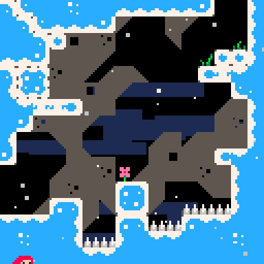
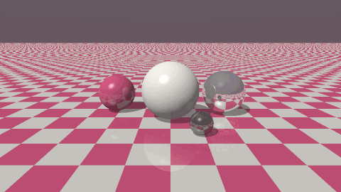
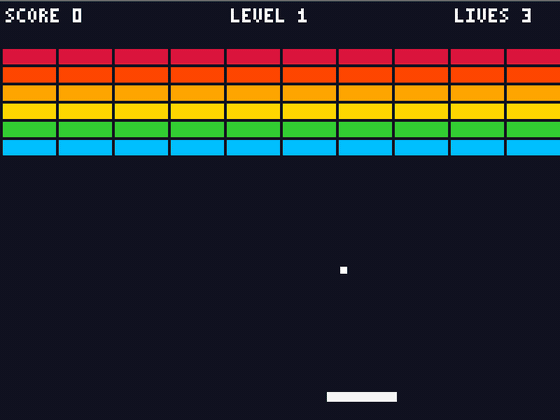

<p align="center">
  
</p>

<p align="center"><b>Curiouser and faster.</b><br>Write it like Ruby. Run it like C. Ship it on all of .NET.</p>

<p align="center">
  <a href="https://alice-lang.org">Website</a> ·
  <a href="https://playground.alice-lang.org">Playground</a> ·
  <a href="https://alice-lang.org/documentation">Docs</a> ·
  <a href="https://github.com/alicelanguage/alice/releases">Releases</a>
</p>

---

> **Status: 1.0 release candidate** (`1.0.0-rc.1`). The language, the guarantees in [INVARIANTS.md](INVARIANTS.md)
> and the CLI are what 1.0 will ship; what is left is listed in the [1.0 checklist](docs/releases.md#10-release-checklist).

Alice is a programming language for .NET. You write blocks, `case/in` and DSLs; the compiler infers static
types, turns whole classes of bugs into compile errors, and makes your loops fast without you asking. Every .NET
library and NuGet package works as is.

```ruby
record struct Vec(x : Float64, y : Float64)
  def +(o : Vec) : Vec = Vec.new(x + o.x, y + o.y)
end

total = (1..1_000_000).map { |i| i.to_i64 * i }.select { |x| x % 2 == 0 }.sum   # one fused loop, no intermediate arrays
puts "total=#{total}"
```

## Why Alice

**1. Your bugs don't compile.** Nil where a value must be, reassigning a `val`, and **two threads touching the
same data** (AL0202) are compile errors, not crashes in production. Integer overflow raises instead of wrapping
silently, and an out-of-range index raises (or traps, in `@[Native]` C). When you want more, say so and the compiler holds
you to it: `pure def` (no side effects), `safe def` (no file, network or process access), `own` and `borrow`
(no buffer is shared or used after it is gone). Write the properties your code must never break in `RULES.al`;
Alice checks every case, or the whole Int32/Int64 range with Z3:

```ruby
rule clamp_stays_in_range(x in -1000..1000, lo in -50..50)
  c = clamp(x, lo, lo + 10)
  c >= lo && c <= lo + 10
end
```

`alice prove --check` fails CI when a rule breaks and prints the input that breaks it.

**2. Fast without trying.** `map/select/sum` chains fuse into one loop with no intermediate arrays, loops
vectorize, independent recursive calls and loop iterations spread across cores, and scratch arrays go back to a
pool instead of the GC. No threads or locks to manage, and nothing runs in parallel unless the compiler has
checked it is safe; when it cannot, the code stays serial (or, with `par for`, you get AL0209 telling you why).

```ruby
a, b = sum_tree(n - 1), sum_tree(n - 1)   # forks near the root, plain calls deeper down

par for y in 0...h                         # parallel, or compile error AL0209
  for x in 0...w
    img[y * w + x] = shade(x, y)
  end
end
```

Repo suite, median of 15, ms (12th Gen Intel Core i5-1235U laptop, Linux, .NET 10.0.4;
[benchmarks/README.md](benchmarks/README.md#results)):

| benchmark | Alice | idiomatic C# | hand-optimized C# |
|---|---:|---:|---:|
| pipeline | 6.9 ms | 26.0 ms | 7.0 ms |
| expr | 8.9 ms | 11.9 ms | - |
| mandelbrot | 116.6 ms | 117.7 ms | - |
| nbody | 50.9 ms | 50.5 ms | - |

Alice is not faster everywhere: the full tables, including the workloads where it is slower, are in
[benchmarks/README.md](benchmarks/README.md#results) and, against C and Bend on a 32-core Linux machine, in
[benchmarks/bend2/results](benchmarks/bend2/results/summary.md) and [benchmarks/bend-vs/results](benchmarks/bend-vs/results/summary.md).

**3. AI can't break it.** The same checks that stop your bugs stop an agent's: code that races, leaks a buffer or
breaks a rule does not compile or fails `alice prove --check`. `alice guide` ships the language reference inside
the CLI, and `alice agents --write` adds Alice rules to your `AGENTS.md`, so an agent checks its own changes and
gets a concrete counterexample when it is wrong. Every guarantee is written down in [INVARIANTS.md](INVARIANTS.md)
with the tests that pin it.

**4. Nothing to give up.** Generics, interfaces, `async/await`, LINQ, spans, ASP.NET, MonoGame, raylib, EF Core,
Avalonia, WebAssembly. C# projects reference Alice libraries and the other way round. Alice compiles to
.NET assemblies with debug info, and errors point at your `.al` lines.

## Made with Alice

| [Celeste Classic](samples/celeste) | [Ray tracer](samples/raytracer) |
|---|---|
| [](samples/celeste) | [](samples/raytracer) |
| **[Breakout](samples/Breakout)** | **[Mandelbrot zoom](samples/fractal)** |
| [](samples/Breakout) | [](samples/fractal) |

All 100% Alice. Celeste Classic is an unofficial educational rewrite of the game by Maddy Thorson and Noel
Berry ([credits](samples/celeste/README.md)). More in [`samples/`](samples) and [`examples/`](examples).

## Get started

```bash
curl -fsSL https://alice-lang.org/install.sh | sh     # Linux, macOS
irm https://alice-lang.org/install.ps1 | iex          # Windows PowerShell
```

The installer verifies its SHA-256 and fetches the .NET 10 SDK if you need it. It installs the latest stable
release; for the release candidate add `--version 1.0.0-rc.1` (or set `ALICE_VERSION=1.0.0-rc.1`). Then:

```bash
alice                      # REPL
alice new app && cd app    # project (alice.toml)
alice run                  # run it
alice add Newtonsoft.Json  # NuGet package
alice test                 # specs and tests
alice agents --write       # teach your AI agent Alice
```

Or try it with no install in the [playground](https://playground.alice-lang.org). Editor support:
`alice lsp --stdio` and the [VS Code / Zed extensions](https://github.com/alicelanguage/extensions).
Toolchains, nightly and building from source: [docs/tooling.md](docs/tooling.md), [docs/releases.md](docs/releases.md).

## Learn more

[Language](https://alice-lang.org/documentation) ·
[Performance](https://alice-lang.org/documentation/guides/max-performance/) ·
[Rules](https://alice-lang.org/documentation/guides/rules-and-proofs/) ·
[Docs index](docs/README.md) ·
[Production readiness](docs/production.md) ·
[Guarantees](INVARIANTS.md) ·
[Architecture](archicture/) ·
[Changelog](CHANGELOG.md)

Alice is a release candidate: please report bugs, and report anything that breaks [INVARIANTS.md](INVARIANTS.md) privately as described in [SECURITY.md](SECURITY.md).

## License

Code: [Apache License 2.0](LICENSE). The Alice name, rabbit logo and brand images are © 2026 Julia Klee, all
rights reserved: use them to refer to Alice, not for commercial exploitation ([details](assets/brand/LICENSE.md)).
