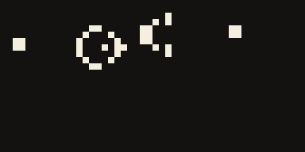

<p align="center">
  
</p>

<p align="center"><b>Curiouser and faster.</b> Write it like Ruby, run it like C, on all of .NET.</p>

---

Alice is a programming language for .NET. You write Ruby/Crystal-style code (blocks, `case/in`, DSLs, `yield`,
`instance_eval`), the compiler infers static types, rejects data races, and lowers your loops into vectorized,
parallel, allocation-free C# — which Roslyn compiles to IL. Every .NET library and NuGet package works as is.

```ruby
record struct Vec(x : Float64, y : Float64)
  def +(o : Vec) : Vec = Vec.new(x + o.x, y + o.y)
end

total = (1..1_000_000).map { |i| i.to_i64 * i }.select { |x| x % 2 == 0 }.sum   # one fused, parallel loop
puts "total=#{total}"

describe "Vec" do
  it "adds" do
    expect(Vec.new(1.0, 2.0) + Vec.new(3.0, 4.0)).to eq(Vec.new(4.0, 6.0))
  end
end
```

## What it looks like

| Game of Life (`samples/life`) | Ray tracer (`samples/raytracer`) |
|---|---|
|  |  |
| **Mandelbrot zoom (`samples/fractal`)** | **The REPL (`alice`)** |
|  |  |

All of these are 100% Alice. The ray tracer renders 960×540 with shadows, mirrors and 4× supersampling in ~0.25 s;
the 60-frame fractal zoom renders in ~1.5 s (i5-1235U).

## Install and first steps

Download an archive from [Releases](../../releases) (Linux x64, Windows x64, macOS x64/arm64; needs the .NET 10
runtime), or build from source:

```bash
git clone https://github.com/kleeedolinux/alice && cd alice
dotnet build src/Alice.Cli -c Release
alias alice="dotnet $PWD/src/Alice.Cli/bin/Release/net10.0/alice.dll"

alice                      # REPL
alice run hello.al         # run a file
alice new app && cd app    # project (alice.toml)
alice add Newtonsoft.Json  # NuGet package (shared .NET cache)
alice test                 # specs and tests
```

## How it works

```
.al source ─▶ Lexer/Parser ─▶ AST ─▶ Binder (types, races, purity) ─▶ HIR
          ─▶ Lowering: iterators → loops, fusion, SIMD, auto-parallel, SoA, FMA ─▶ MIR
          ─▶ C# (with #line → your .al lines) ─▶ Roslyn ─▶ IL  (+ optional C via clang for @[Native])
```

| Part | Where | What it does |
|---|---|---|
| Syntax | `src/Alice.Compiler/Syntax` | Ruby/Crystal grammar: blocks, `do…end`, heredocs, `%w`, `case/in` patterns, endless defs |
| Binder | `src/Alice.Compiler/Semantics` | type inference, generics, nil-safety, **data-race errors (AL0202)**, purity analysis |
| Lowering | `src/Alice.Compiler/Lowering` | `map/select/sum` chains → one loop; vectorization; parallel loops only when proven pure; SoA layout; FMA |
| Backend | `src/Alice.Compiler/Backend` | C# emitter with `#line`, Roslyn compile, error translation to Alice terms, C emitter for `@[Native]` |
| Runtime | `src/Alice.Runtime` | Ruby-style Prelude, SIMD, sparse matrices, `Par`, channels/actors, spec framework, REPL host |
| CLI | `src/Alice.Cli` | `alice` command, projects (`alice.toml`, workspaces, `alice.lock`), REPL, packages, localized output (en/pt/es) |

## What you can do

- **Everything .NET**: namespaces, generics, interfaces, events, `async/await`, `for await`, LINQ, spans, NuGet, ASP.NET,
  MonoGame, raylib. C# projects can reference Alice libraries and vice versa (`samples/CSharpApp`).
- **Ruby ergonomics**: blocks, `yield`, `instance_eval`/`instance_exec`, class-body macros, `define_method`,
  `method_missing`, `send`, `@@class_vars`, `attr_accessor`, monkey patching, `Comparable`/`Enumerable`, `case/in`.
- **Safety**: static types everywhere, nil-safety, immutable `val`, compile-time data-race detection.
- **Speed**: auto-vectorized and auto-parallel loops, fused pipelines, SoA records, FMA contraction, `@[Native]`
  functions compiled by clang. See [benchmarks](benchmarks/README.md): Alice beats idiomatic C# on all 8 and
  matches or beats C on the 5 C benchmarks.
- **Tooling**: REPL with help/shell/package modes, RSpec + xUnit style tests, formatter, readable errors
  (`AL0303 undefined name 'x'`, never raw C#), "did you mean" everywhere, NuGet via `add/remove/search/list`.

## Samples

| Sample | Shows |
|---|---|
| [`samples/life`](samples/life) | Game of Life, terminal animation, frame export |
| [`samples/raytracer`](samples/raytracer) | operator overloading on value types, parallel rendering, image output |
| [`samples/fractal`](samples/fractal) | parallel Mandelbrot zoom video |
| [`samples/wonderland`](samples/wonderland) | text adventure written as a Ruby-style DSL |
| [`samples/celeste`](samples/celeste) | Celeste Classic rewritten in Alice (raylib), 28 tests |
| [`samples/Breakout`](samples/Breakout), [`BounceGame`](samples/BounceGame) | MonoGame games |
| [`samples/AliceLib`](samples/AliceLib) + [`CSharpApp`](samples/CSharpApp) | C# ⇄ Alice interop |
| [`examples/`](examples) | basics, data/JSON, channels, ASP.NET API |

## Docs

[Language](docs/language.md) · [Tooling & REPL](docs/tooling.md) · [Errors](docs/errors.md) ·
[Performance](docs/performance.md) · [Architecture](archicture/README.md) · [Changelog](CHANGELOG.md)

## Roadmap

- Incremental compilation and a language server (editor completion, go-to-definition).
- Broader race analysis (prove disjoint `y * w + x` writes so more loops parallelize safely).
- GPU offload for `Par` kernels; more `@[Native]` coverage (structs, strings).
- Refinements, `ObjectSpace`, `class_eval` with strings.
- NativeAOT single-file `alice` binary; package registry for Alice libraries.

## License

Code: [Apache License 2.0](LICENSE). The Alice name, rabbit logo and brand images are © 2026 Julia Klee, all
rights reserved — use them to refer to Alice, not for commercial exploitation ([details](assets/brand/LICENSE.md)).
