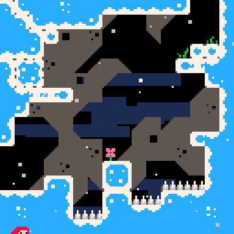
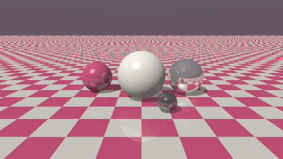
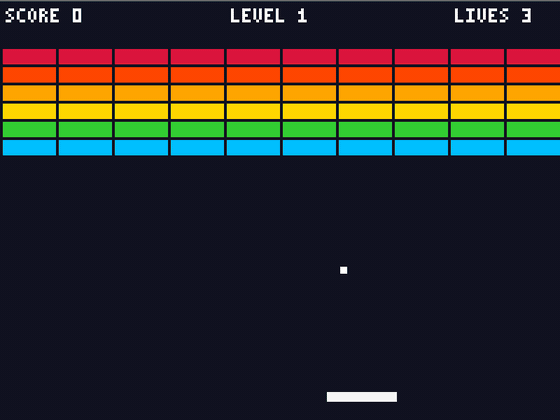
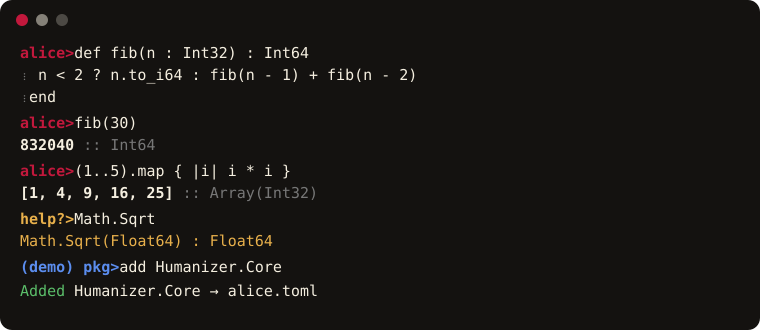

<p align="center">
  
</p>

<p align="center"><b>Curiouser and faster.</b> Write it like Ruby, run it like C, on all of .NET.</p>

---

Alice is a programming language for .NET. You write Ruby/Crystal-style code (blocks, `case/in`, DSLs, `yield`,
`instance_eval`), the compiler infers static types, rejects data races, and lowers your loops into vectorized,
parallel, allocation-free C# — which Roslyn compiles to IL. Every .NET library and NuGet package works as is.

```ruby
record struct Vec(x : Float64, y : Float64)
  def +(o : Vec) : Vec = Vec.new(x + o.x, y + o.y)
end

total = (1..1_000_000).map { |i| i.to_i64 * i }.select { |x| x % 2 == 0 }.sum   # one fused, parallel loop
puts "total=#{total}"

describe "Vec" do
  it "adds" do
    expect(Vec.new(1.0, 2.0) + Vec.new(3.0, 4.0)).to eq(Vec.new(4.0, 6.0))
  end
end
```

## What it looks like

| [Celeste Classic (`samples/celeste`)](samples/celeste) | Ray tracer (`samples/raytracer`) |
|---|---|
| [](samples/celeste) |  |
| **[Breakout (`samples/Breakout`)](samples/Breakout)** | **Mandelbrot zoom (`samples/fractal`)** |
| [](samples/Breakout) |  |
| **The REPL (`alice`)** | **[Playground](https://playground.alice-lang.org)** |
|  | Edit and run Alice in your browser; inspect HIR, MIR, C# and IL at [playground.alice-lang.org](https://playground.alice-lang.org) |

All of these are 100% Alice. The ray tracer renders 960×540 with shadows, mirrors and 4× supersampling in ~0.25 s;
the 60-frame fractal zoom renders in ~1.5 s (i5-1235U).

Celeste Classic is an unofficial educational rewrite of the game by Maddy Thorson and Noel Berry;
see the sample's [run instructions and original credits](samples/celeste/README.md).

## Install and first steps

```bash
# Linux and macOS
curl -fsSL https://alice-lang.org/install.sh | sh
```

```powershell
# Windows (PowerShell; no administrator rights, no Visual Studio)
irm https://alice-lang.org/install.ps1 | iex
```

The installer picks the build for your platform from [Releases](https://github.com/alicelanguage/alice/releases),
verifies its SHA-256, installs the .NET 10 SDK per-user if it is missing, and puts `alice` on your PATH.
Options: `sh -s -- --nightly`, `--version 0.11.0`, `--no-modify-path`, `--no-dotnet` (PowerShell: `-Version`, `-NoDotnet`, …).

```bash
alice                      # REPL: highlighting, Tab completion, ↑ history search, ?help ;shell ]packages
alice run hello.al         # run a file
alice new app && cd app    # project (alice.toml)
alice add Newtonsoft.Json  # NuGet package (shared .NET cache)
alice test                 # specs and tests
alice doctor               # check .NET, PATH, toolchains
```

Several versions side by side, rustup-style:

```bash
alice toolchain install nightly     # stable, nightly or a version
alice toolchain default 0.11.0
alice toolchain pin 0.11.0          # per project (writes ./alice-toolchain)
alice +nightly run app.al           # one-off
alice self update                   # update; a notice appears when a new release is out
```

Details: [releases and installers](docs/releases.md), [toolchains](docs/tooling.md#toolchains).
Build from source instead:

```bash
git clone https://github.com/alicelanguage/alice && cd alice
dotnet build src/Alice.Cli -c Release
alias alice="dotnet $PWD/src/Alice.Cli/bin/Release/net10.0/alice.dll"
```

## Editor support

Alice includes `alice lsp --stdio`. The [Rust editor extensions](https://github.com/alicelanguage/extensions)
add completion, diagnostics, .NET/NuGet assistance, automatic imports, hover,
formatting, highlighting and icons to VS Code, VSCodium and Zed. Install the
matching VSIX or use Zed's dev extension installer. See [tooling](docs/tooling.md#editor-support).

## How it works

```
.al source ─▶ Lexer/Parser ─▶ AST ─▶ Binder (types, races, purity) ─▶ HIR
          ─▶ Lowering: iterators → loops, fusion, SIMD, auto-parallel, SoA, FMA ─▶ MIR
          ─▶ C# (with #line → your .al lines) ─▶ Roslyn ─▶ IL  (+ optional C via clang for @[Native])
```

| Part | Where | What it does |
|---|---|---|
| Syntax | `src/Alice.Compiler/Syntax` | Ruby/Crystal grammar: blocks, `do…end`, heredocs, `%w`, `case/in` patterns, endless defs |
| Binder | `src/Alice.Compiler/Semantics` | type inference, generics, nil-safety, **data-race errors (AL0202)**, purity analysis |
| Lowering | `src/Alice.Compiler/Lowering` | `map/select/sum` chains → one loop; vectorization; parallel loops only when proven pure; SoA layout; FMA |
| Backend | `src/Alice.Compiler/Backend` | C# emitter with `#line`, Roslyn compile, error translation to Alice terms, C emitter for `@[Native]` |
| Runtime | `src/Alice.Runtime` | Ruby-style Prelude, SIMD, sparse matrices, `Par`, channels/actors, spec framework, REPL host |
| CLI | `src/Alice.Cli` | `alice` command, projects (`alice.toml`, workspaces, `alice.lock`), REPL, packages, localized output (en/pt/es) |

## What you can do

- **Everything .NET**: namespaces, generics, interfaces, events, `async/await`, `for await`, LINQ, spans, NuGet, ASP.NET,
  MonoGame, raylib. C# projects can reference Alice libraries and vice versa (`samples/CSharpApp`).
- **Ruby ergonomics**: blocks, `yield`, `instance_eval`/`instance_exec`, class-body macros, `define_method`,
  `method_missing`, `send`, `@@class_vars`, `attr_accessor`, monkey patching, `Comparable`/`Enumerable`, `case/in`.
- **Safety**: static types everywhere, nil-safety, immutable `val`, compile-time data-race detection.
- **Speed**: auto-vectorized and auto-parallel loops, fork/join recursion, GC-free owned buffers, fused pipelines, SoA records, FMA contraction, `@[Native]`
  functions compiled by clang. See [benchmarks](benchmarks/README.md): Alice beats idiomatic C# on 6 of 7 in run 8 (binarytrees: 1.02×) and
  matches or beats C on the 5 C benchmarks.
- **Tooling**: REPL with help/shell/package modes, RSpec + xUnit style tests, formatter, readable errors
  (`AL0303 undefined name 'x'`, never raw C#), "did you mean" everywhere, NuGet via `add/remove/search/list`.

## Mutability, ownership and parallelism

### Mutability

A local binding is mutable unless you declare it with `val`. In a class, `getter` makes a field read-only from
outside and `property` makes it readable and writable. `val` only stops the name from being rebound. It does not
freeze the object it refers to: a `val` array can still have its elements written.

```ruby
count = 1               # mutable binding
val limit = 10          # reassigning it is a compile error
val xs = [1, 2, 3]
xs[0] = 9               # allowed: the binding is fixed, the array is not
```

Mutation is also what the compiler checks for races. If concurrent code writes shared state that another task can
reach, that is compile error AL0202. Loops and forks are parallelized only when their bodies are proven pure.

### Ownership (0.12)

.NET's garbage collector stays as the safety net. On top of it, the compiler tracks which local arrays are the only
reference to their buffer. When such an array is dropped, its memory goes back to a per-thread pool instead of to
the GC, and the next `Array(T).new(n)` of the same length reuses it. A dynamic-programming loop that builds a fresh
row each iteration allocates two rows in total:

```ruby
def edit_distance(a : String, b : String) : Int32
  previous = Array(Int32).new(b.size + 1)
  for j in 0..b.size
    previous[j] = j
  end
  for i in 1..a.size
    row = Array(Int32).new(b.size + 1)    # reuses the buffer released below
    row[0] = i
    for j in 1..b.size
      cost = a[i - 1] == b[j - 1] ? 0 : 1
      row[j] = [row[j - 1] + 1, previous[j] + 1, previous[j - 1] + cost].min
    end
    previous = row                        # move: the old row returns to the pool
  end
  previous[b.size]
end
```

Inference happens silently: an array that escapes into a field, a closure or a .NET call stays an ordinary GC
array. Write `own` to turn the rules into a contract, so that an escape is error AL0207 and a use after a move is
error AL0208:

```ruby
own scratch = Array(Float64).new(1024)
```

### Memory: where Alice beats the GC

Alice keeps .NET's garbage collector as a safety net, but most hot-loop memory never reaches it:

- **Owned arrays** go back to a per-thread pool when the program drops them, and the next allocation of the same
  size reuses them. Rolling rows, scratch buffers and frame buffers allocate once instead of once per iteration.
- **Owned results**: an array a function builds and returns is recycled by its caller.
- **In-place updates**: `xs = xs.map { }` on an owned array overwrites it instead of allocating a copy.
- **Shared immutable objects**: `Leaf.new(nil, nil)` in a tree builder is one instance, not one per leaf.
- **Stack arrays** for small fixed-size locals, and **lifetime regions** (`scope ... end`) that free a large
  temporary as soon as the region ends.

No reference counting, no runtime checks, no `try/finally` in hot code: the compiler proves where each array is
the only reference. When it cannot prove it, the array is an ordinary GC array, so a missed optimization costs
an allocation, never safety.

Measured against idiomatic C# doing the same work ([`benchmarks/gc`](benchmarks/gc), 7 runs, server GC):

| workload | allocated per run: Alice / C# | collections: Alice / C# | GC pause: Alice / C# | time: Alice / C# |
|---|---:|---:|---:|---:|
| rolling DP rows | 0.00 / 61.4 MiB | 0 / 172 | 0 / 16.0 ms | 43.0 / 50.0 ms |
| per-call scratch buffers | 0.00 / 596.6 MiB | 0 / 1672 | 0 / 92.2 ms | 258.8 / 315.0 ms |
| 4 MiB frames | 0.00 / 484.0 MiB | 0 / 192 | 0 / 131.6 ms | 197.5 / 471.2 ms |
| binary trees (objects) | 34.0 / 68.0 MiB | 83 / 63 | 32.7 / 46.9 ms | 21.6 / 29.5 ms |

Peak memory follows: 49 MiB for Alice against 131 MiB for C# on the frames workload. Under workstation GC the
array workloads run at the same speed as C# with the same zero collections. A 3-stage `map` pipeline over
1M `Float64` takes 4.0 ms and 3 bytes per call in Alice, against 9.3 ms and 32 MB in hand-written C#.

### Fork/join and parallel loops

You don't create threads. Two independent bindings where at least one is a recursive call fork onto the thread
pool, and a counted loop whose iterations are proven independent runs in chunks across cores:

```ruby
def sum_tree(n : Int32) : Int64
  return 1_i64 if n == 0
  a, b = sum_tree(n - 1), sum_tree(n - 1)   # forks near the root, plain calls deeper down
  a + b
end

par for y in 0...h                           # parallel at any size, or compile error AL0209
  for x in 0...w
    img[y * w + x] = shade(x, y)
  end
end
```

A fork costs one pooled work item. If no worker picks it up, the joining thread runs it inline, and only the top
`log2(cores) + 3` levels of the call tree fork at all. Parallel loops share a chunk scheduler in which the calling
thread does work too, so nested loops can't starve the pool, and exceptions reach the caller unwrapped. A loop that
reads the array it writes at another index (`row[j - 1]`) stays serial. For hashes and PRNGs, `unchecked ... end`
or `&+ &- &*` turn off the overflow checks.

### Explicit contracts (0.12.2)

Inference stays the default. When you want a guarantee, say it, and the compiler proves it or stops with an error:

```ruby
pure def work(n : Int64) : Int64 ... end              # no effects, or AL0210
safe def score(xs : Array(Int32)) : Int32 ... end     # cannot reach files, network, processes (AL0212)
par a, b = work(n), work(n + 1)                       # always forks (AL0211)

def scale(own xs : Array(Float64), k : Float64) : Array(Float64)
  xs = xs.map { |v| v * k }                           # owned: updated in place, no new array
  xs
end
def total(borrow xs : Array(Int64)) : Int64 ... end   # never keeps xs (AL0213)

scope                                                 # lifetime region: arrays inside die at `end`
  tmp = Array(Int32).new(n)
end
```

Arrays a function returns are recycled by its caller, immutable objects built from constants are shared, and
`fib(n - 1) + fib(n - 2)` forks directly. `alice explain file.al` lists, per method, which of these the compiler
applied.

### Rules and proofs

Inspired by Bend's `LAWS.bend`: write the properties your program must never break in `RULES.al`, over finite
domains, and `alice prove` checks every case:

```ruby
# RULES.al
rule clamp_stays_in_range(x in -1000..1000, lo in -50..50)
  c = clamp(x, lo, lo + 10)
  c >= lo && c <= lo + 10
end
```

Rules are pure (enforced), so checking every input is a proof by exhaustion, not a sample. `alice prove` writes
`PROOF.al`, a certificate with each result and a hash of the sources. `alice prove --check` fails in CI when a
rule breaks or the code changed without re-proving; a failure prints the exact counterexample. Alice proves its
own numeric semantics this way: see [`RULES.al`](RULES.al) and [`PROOF.al`](PROOF.al).

### The guide, for people and AI agents

`alice guide` prints the Alice guide, embedded in the CLI so it always matches the installed version. Topics:
`alice guide performance` (including when each tool is worth using), `alice guide proofs`, `alice guide interop`.
`alice agents --write` adds an Alice block to your project's `AGENTS.md`: how to check and prove changes, and the
Ruby/Crystal habits that are wrong in Alice. Sources: [`guide/`](guide).

### Benchmarks

Alice compared with C#, both under server GC, from the repo suite ([run 8](benchmarks/README.md), i5-1235U, lower is better):

| benchmark | Alice ms | idiomatic C# ms | hand-optimized C# ms |
|---|---:|---:|---:|
| nbody | 47.8 | 53.3 | 48.9 |
| binarytrees | 171.3 | 167.6 | 91.4 |
| pipeline | 2.0 | 37.7 | 2.1 |
| expr | 10.3 | 11.0 | 10.5 |
| wordfreq | 6.9 | 80.5 | 5.3 |
| mandelbrot | 9.7 | 104.5 | 8.7 |
| parallel | 34.8 | 40.4 | 34.0 |

On the 17-workload polyglot suite, Alice is faster than C# on 10, including tree-radix (3.2×), symreg (2.0×),
hashmap (1.45×) and merkle (1.2×). The other 7 are within 2–12 %. See
[how to get maximum performance](https://alice-lang.org/documentation/guides/max-performance/).

## Samples

| Sample | Shows |
|---|---|
| [`samples/life`](samples/life) | Game of Life, terminal animation, frame export |
| [`samples/raytracer`](samples/raytracer) | operator overloading on value types, parallel rendering, image output |
| [`samples/fractal`](samples/fractal) | parallel Mandelbrot zoom video |
| [`samples/wonderland`](samples/wonderland) | text adventure written as a Ruby-style DSL |
| [`samples/wonderland3d`](samples/wonderland3d) | psychedelic 3D film, deterministic 30-second MP4 export and Alice-synthesized music |
| [`samples/celeste`](samples/celeste) | Celeste Classic rewritten in Alice (raylib), 28 tests |
| [`samples/Breakout`](samples/Breakout), [`BounceGame`](samples/BounceGame) | MonoGame games |
| [`samples/AliceLib`](samples/AliceLib) + [`CSharpApp`](samples/CSharpApp) | C# ⇄ Alice interop |
| [`examples/`](examples) | basics, data/JSON, channels, ASP.NET API |

## Docs

Is it ready for production? See [docs/production.md](docs/production.md): what is covered, by which tests, and the known gaps.

[Language](https://alice-lang.org/documentation) · [Tooling & REPL](https://alice-lang.org/documentation) · [Errors](https://alice-lang.org/documentation) ·
[Performance](https://alice-lang.org/documentation) · [Architecture](https://alice-lang.org/documentation) · [Changelog](https://alice-lang.org/documentation)

## Roadmap

- File-level incremental compilation (packages are incremental since 0.12.3).
- Ownership for collections held in fields (local arrays of numbers and local lists and hashes of any type are owned since 0.12.3).
- Rules over unbounded domains (induction) in `RULES.al`.
- Device-resident data across `gpu for` loops (GPU loops and kernels run through ILGPU since 0.12.3); more `@[Native]` coverage (structs, strings).
- `class_eval` with strings (refinements and class discovery via `ObjectSpace` are in since 0.12.3).
- NativeAOT single-file `alice` binary (libraries are distributed on NuGet: `alice publish`, ADR 0020).

## License

Code: [Apache License 2.0](LICENSE). The Alice name, rabbit logo and brand images are © 2026 Julia Klee, all
rights reserved — use them to refer to Alice, not for commercial exploitation ([details](assets/brand/LICENSE.md)).
