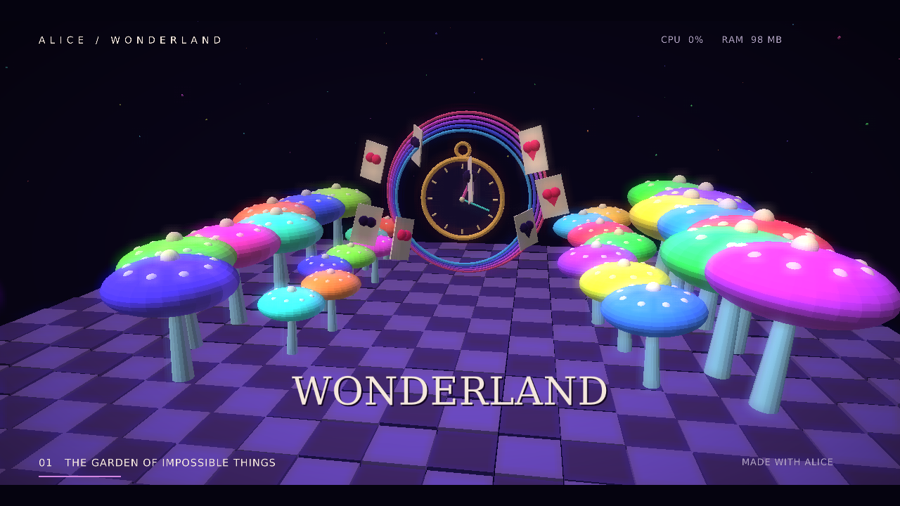

# Wonderland3D

A 30-second procedural 3D film written in Alice: a neon mushroom garden, flying playing cards, a floating tea party, the Cheshire grin, and a spiralling rabbit hole. A camera flick through the final ring rewinds the spiral. The preview overlays live Alice process CPU and RAM use. Includes bloom, shaded geometry, choreographed cameras, typography and an original synthesized stereo music-box score.



From this directory, with Alice, .NET 10 and an OpenGL 3.3 desktop available:

```sh
alice run --release
```

Playback loops; Escape closes the window. To generate a **1280 × 720, 30 fps, 30-second H.264/AAC MP4**, install FFmpeg with `libx264` and run:

```sh
alice run --release -- --render wonderland3d.mp4
```

The render advances by exact frame time, independent of GPU speed. Keep the window open until all 900 frames finish. FFmpeg encodes the video and Alice removes the temporary PNGs after successful encoding. On cancellation or encoding failure, the temporary directory is retained for recovery. Export includes music; interactive playback is silent.

```sh
# Higher-resolution film
alice run --release -- --render wonderland3d.mp4 --width 1920 --height 1080 --fps 30
# Inspect a particular composition (time must be in [0, 30))
alice run --release -- --still tea.png --time 15
# Timeline tests
alice test
```

In this checkout, replace `alice` with `dotnet ../../src/Alice.Cli/bin/Release/net10.0/alice.dll` after building the CLI. Run from this directory so the shader and font paths resolve.

| Time | Scene |
|---|---|
| 0–10 s | A dolly through the mushroom garden toward a floating pocket watch |
| 10–20 s | An orbit around levitating tea, cards and the Cheshire grin |
| 20–30 s | A rolling camera inside the animated rainbow rabbit hole |

`src/world.al` constructs and animates all 3D geometry; `timeline.al` defines deterministic timing; `music.al` synthesizes PCM audio; `main.al` drives Raylib, frame capture and FFmpeg through .NET interop. The four small GLSL shaders provide GPU lighting and bloom. No handwritten C# or downloaded models are used. Raylib is a native dependency of this sample, like Celeste; the Alice compiler/runtime remain unchanged.

The scene and score are original procedural work inspired by Lewis Carroll's Wonderland. Bundled DejaVu Sans/Serif fonts are redistributed under [their license](assets/FONT-LICENSE.txt).
